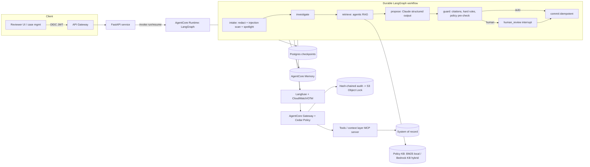

# Appetite: agentic AI for Insurance (small commercial property underwriting)

> Portfolio project. **All data is synthetic.** Status: core agent VALIDATED by tests (offline); AWS deploy DRAFT.

## Problem and outcome
Broker submission triage. Appetite checks appetite rules, rates the risk with the rating plan, recalls prior decisions for the insured (long-term memory), and QUOTEs within delegated authority or REFERs; only underwriters DECLINE or email brokers.

- Outcomes: QUOTE (agent, TIV<=5M & premium<=50k), REFER (agent), DECLINE (underwriter)
- Human roles: uw_agent, underwriter, senior_underwriter
- Release gate (critical miss): QUOTE when it should be REFER/DECLINE (adverse selection, authority breach) must be 0%.
- Baseline (rules model, offline): 95.5% accuracy, 0 critical misses, 100% injection resilience (22 cases). Miss U05 needs the broker narrative (sprinkler retrofit).

## Architecture


Failure paths: model refusal / budget exceeded / schema failure -> NEEDS_HUMAN (fail safe, never open). Tool transient error -> bounded retry with jitter. Worker crash -> resume same thread_id from last checkpoint; commit is idempotent (exactly-once effect). Invalid human sign-off -> rejected before resume, and the node re-interrupts if bypassed.

## Skills applied (course map)
| Skill | Where |
|---|---|
| ADLC / Claude Code | `AGENTS.md`, spec-first, tests as contract |
| Harness engineering | `agentkit/decision_graph.py` fixed workflow; LLM only proposes |
| Model selection | `agentkit/models.py` catalog + `RoutingRule`, env overrides, heuristic baseline floor |
| Evals + Langfuse | `evals/golden.jsonl`, `evals/run_evals.py`, `agentkit/evals.py` (critical-miss gate, LLM judge, Langfuse push) |
| Agentic RAG over MCP | `agentkit/retrieval.py` multi-query evidence + sufficiency; `agentkit/mcp_server.py` (`search_policy`) |
| Durable state + HITL | LangGraph checkpointer + `interrupt()` / `Command(resume=)` |
| Guardrails / lethal trifecta | `agentkit/guardrails.py`, trifecta check in `agentkit/gateway.py` |
| AI gateway / policy | `agentkit/gateway.py` + `policies/*.cedar` (parity tested) |
| AgentCore deploy | `agentkit/service.py` entrypoint, `deploy/` |

Tools: get_submission, get_account_history (memory), appetite_check, rate_risk, record_decision, send_quote_to_broker (humans only, approval-gated)

## Key decisions (ADRs)
1. **Fixed graph, LLM proposes only** - arithmetic, thresholds and writes are code; cheaper, testable, auditable. Rejected: free ReAct loop (non-deterministic side effects).
2. **Defence in depth on authority** - Cedar at AgentCore Gateway + same rules in-app + graph guard + reviewer-role validation. Rejected: prompt-only rules.
3. **Model**: claude-sonnet-5-5 (structured, lower-stakes triage; cheaper). Re-decided only on eval evidence (accuracy, critical miss, cost/case).
4. **BM25 locally, hybrid in AWS** - policy manuals are term-heavy (codes, thresholds); add dense + rerank when evals show recall gaps.
5. **Postgres checkpointer** for durable state across workers; AgentCore Memory only for long-term memory.

## Security and compliance
NAIC Model Audit Rule & state rate/form filing (premium only from filed rating plan), NAIC AI Model Bulletin (governance, testing, third-party models), Unfair Trade Practices (consistent declinations), SOC 2, GLBA.
- Prompt injection: heuristic scan + nonce-bound spotlighting + no instruction-following rule; suspicious text forces human review. Authority never depends on the model obeying.
- PII/PHI: tokenizing redaction before prompts, logs and checkpoints (raw untrusted text dropped from state). Production adds Comprehend Medical / Presidio NER.
- Lethal trifecta: gateway refuses any role combining private data + untrusted content + un-gated egress.
- AuthN at API Gateway (OIDC); AuthZ re-checked in graph and gateway. Audit log hash-chained (tamper-evident).
- Status: controls VALIDATED by unit tests; SOC 2 / regulatory compliance NOT claimed (needs evidence collection).

## Cost estimate (illustrative, 5k submissions/day)
Assume ~6k input + 800 output tokens/case. First-party list prices (Nov 2026): Opus 5.5 $4/$20, Sonnet 5.5 $2/$10, Haiku 5.5 $0.10/$0.50 per MTok; **Bedrock pricing differs - confirm.**
- Opus 5.5: ~$0.040/case; Sonnet 5.5: ~$0.020/case; Haiku 5.5: ~$0.001/case.
- FinOps: prompt caching of system+policy prefix (largest lever), route clear-cut cases to heuristic/Haiku, Batch for non-urgent backlog, eval-gated model downgrades.
- Infra (AgentCore Runtime, Aurora Serverless v2, Gateway, CloudWatch): roughly $1.5k-4k/month at this volume; dominated by tokens.

## Run (Windows/VS Code, no Docker)
```powershell
uv venv; uv pip install -e ../../platform/agentkit -e ".[dev]"
uv run pytest -q
uv run python evals/run_evals.py            # offline baseline
$env:AGENT_LLM_MODE="live"; $env:AWS_REGION="us-east-1"; uv run python evals/run_evals.py   # Claude on Bedrock
$env:AGENT_API_KEY="dev-key"; uv run uvicorn appetite.app:api --reload
uv run python -m appetite.app mcp         # MCP context-layer server (stdio)
```

## Deploy (DRAFT, AWS Bedrock AgentCore)
See `deploy/README.md`. Build in the cloud (CodeBuild) - no local Docker. `agentcore deploy` with `appetite.app` entrypoint; Gateway target = MCP server; Cedar policies in `policies/` (log-only first, then enforce). Rollback: redeploy previous runtime version; checkpoints are forward-compatible by additive state keys.

## Next steps
Run live evals on Bedrock and record Langfuse experiment; add LLM-judge grades; validate Cedar schema in a sandbox account; Terraform for Aurora/KMS/S3 Object Lock; red-team set (50+ injection variants).
